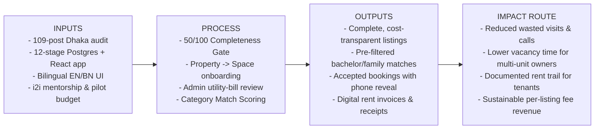

# Habito — i2i One-Pager (Problem → User → Output → Impact Route)

> **Project:** Habito — Space-Rental Marketplace for Bangladesh  
> **Live Prototype:** [https://habito-live.vercel.app](https://habito-live.vercel.app)  
> **Program:** IUB Innovation to Impact (i2i) Incubation Program  
> **Document Date:** 4 November 2026  
> **Team & Faculty Advisor:** `EVIDENCE NEEDED: Insert full names, IUB Student IDs, departments, and Faculty Advisor name/email before submission.`

---

## 1. The Problem (Backed by Primary Audit Evidence)

In Dhaka, finding or letting a rental space—whether a flat, single room, partition room, ground-floor shop, godown, or garage slot—relies heavily on unstructured Facebook "to-let" groups and paper street signs.

Between **4 August 2026 and 19 September 2026**, we conducted a primary audit of **109 unique, deduplicated rental posts across 62 Dhaka-area Facebook to-let groups** (Source: *Habito — Rental Listing Audit*, `.user_uploaded`). The audit documented systematic information gaps that waste renters' and owners' time:

- **23.9% (26 of 109 posts)** did not state a rent amount at all (forcing "inbox for price" messages), and almost none broke down hidden service charges, utility estimates, or advance deposits.
- **24.8% (27 of 109 posts)** did not state an availability or move-in date, leaving stale listings circulating for weeks.
- **8.3% (9 of 109 posts)** gave no location detail beyond a broad area name (no road, block, or sector).
- **8.3% (9 of 109 posts)** did not state who the space was open to (family, bachelor, student, or gender restrictions), leading to immediate phone rejection for bachelor and student renters.
- **35.8% (39 of 109 posts)** omitted bedroom count, and **89.0% (97 of 109 posts)** omitted furnished status.

Furthermore, existing property portals treat a listing as a whole residential flat or building, ignoring how Bangladeshi property owners actually operate: **one building (`Property`) contains heterogeneous rentable units (`Spaces`)**—flats upstairs, partition/single rooms, a ground-floor shop, a godown, and parking slots—managed by one owner or caretaker.

---

## 2. Specific First User (Beachhead Segment)

Rather than targeting "all of Bangladesh" on day one, Habito's initial beachhead focuses on the highest-density segment identified in our 109-post audit (**Bashundhara R/A: 23.9%, Badda: 16.5%, Mohammadpur: 15.6%**):

1. **Demand Side (First Renter Persona):** University students (starting with IUB students and staff) and young working bachelors/small families searching in **Bashundhara R/A and Badda** for single rooms, seats/partitions, or 2–3 bedroom flats who need upfront total monthly cost (rent + service charge + utilities + advance) and explicit bachelor/student eligibility before making a phone call.
2. **Supply Side (First Owner Persona):** Small-to-medium multi-unit building owners and their on-site **caretakers** (`property_managers`) in **Bashundhara R/A and Badda** who manage 1–3 buildings containing a mix of flats, single/partition rooms, ground-floor shutter shops, and garage parking slots.

---

## 3. Existing Output (What Is Already Built & Tested)

Habito is a working, deployed bilingual (English / বাংলা) web application ([https://habito-live.vercel.app](https://habito-live.vercel.app)) backed by a 12-stage PostgreSQL + Row-Level Security schema (`supabase/migrations/0001_schema.sql` through `0012_listing_fees.sql`):

- **Audit-Driven Completeness Gate (`0006_trust.sql`):** A listing cannot be published unless it scores at least **50/100** on `listing_completeness()` (Full cost breakdown: 30, Address: 20, Neighbourhood: 10, 2+ photos: 20, Description ≥60 chars: 10, Availability date: 10).
- **Property → Space Portfolio (`0001_schema.sql`, `0012_listing_fees.sql`):** Owners group flats, partition rooms, shops, godowns, and parking under a single building and delegate management to caretakers (`0005_bookings.sql`).
- **Transparent Category Match Scoring (`README.md`):** Deterministic arithmetic scoring (out of 100) tailored separately for Living, Business, Storage, Parking, and Land—never black-box AI.
- **Privacy-Preserving Booking & Rent Ledger (`0005_bookings.sql`, `0007_payments.sql`):** Enforces `requested → accepted → confirmed → completed`, reveals phone numbers only after owner acceptance, and generates monthly rent invoices and sequential receipts (`HAB-2026-xxxxxx`, currently using a clearly labelled simulated payment step).
- **Usability Validation (*Habito — Product Overview* PDF):** Tested by **65 people** via a bilingual usability and feedback survey, with **34 participants completing an actual end-to-end renter or owner task** in the application.

---

## 4. Logic Model: Inputs → Process → Outputs → Impact Route

### Detailed Logic Chain

| Stage | Concrete Elements | Verification / Metric |
|---|---|---|
| **Inputs** | • Empirical findings from 109 Dhaka Facebook to-let posts (Aug–Sep 2026) • Deployed Vite/React/TypeScript + Supabase PostgreSQL web app (`0001`–`0012` migrations) • Bilingual interface (English & spoken-register বাংলা with Bengali numerals) • Usability feedback from 65 testers (34 task completers) | Verified in repo & uploaded PDFs (`.user_uploaded`); raw CSVs queued in `evidence-register.md` (E-15, E-16). |
| **Process (Activities)** | • Enforce the 50/100 `listing_completeness()` gate at publish time • Onboard multi-unit owners and caretakers in Bashundhara R/A & Badda • Verify ownership claims via `/admin` (inspecting utility bill/holding tax receipt and deleting the file immediately per `MODERATION.md`) • Match seekers via category-specific arithmetic weights and occupancy filters | Tracked via PostgreSQL tables: `spaces`, `properties`, `moderation_actions`, `inquiries`, `bookings`. |
| **Outputs** | • Real (`is_seed = false`) listings with 100% disclosed total monthly cost, neighbourhood/road detail, occupancy eligibility, and availability date • Qualified inquiry threads and accepted booking requests where phone numbers are exchanged consensually • Monthly digital rent schedules and sequential receipts | Count of published `is_seed = false` spaces, `reviewed` owners, inquiry-to-acceptance conversion rate. |
| **Impact Route & Revenue Model** | • **For Renters (Students/Bachelors/Families):** Eliminates "inbox for price" and wasted travel to buildings that reject bachelors or hide service charges. • **For Owners/Caretakers:** Centralises mixed-use building vacancies (flats + shops + parking) and provides a clean digital rent ledger. • **Commercial Sustainability (Assumption to Validate in Pilot):** First 3 listings/property/calendar month are free; subsequent listings charged per category (Living ৳200, Business ৳500, Storage ৳400, Parking ৳100, Land ৳500) or ৳5,000/year property plan (`0012_listing_fees.sql`). | Pilot validation of owner retention, time-to-let reduction, and willingness to pay after the 3-free-listing allowance. |
